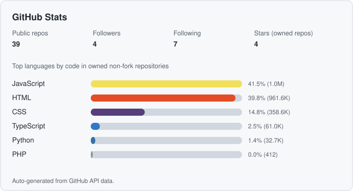
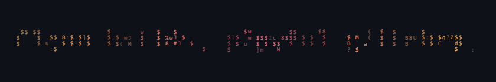

# Hi, I'm ҪHΛNDRΛSЄN𝟟𝟜

**Creative developer building playful web experiments, interactive UIs, and clean browser experiences.**

I vibe-code with [OpenCode](https://opencode.ai), ship small ideas as demos, then polish them step by step.

  
  
  

---

## Featured projects

| Project | What it is | Stack | Links |
| --- | --- | --- | --- |
|  [friday](https://github.com/Chandrasen74/friday) | Local-first Android assistant (F.R.I.D.A.Y) with on-device LiteRT-LM inference, remote API support, and chat persistence. | Kotlin, Jetpack Compose | [Repo](https://github.com/Chandrasen74/friday) · [Release](https://github.com/Chandrasen74/friday/releases/tag/v0.9.0) |
|  [clockinaclock](https://github.com/Chandrasen74/clockinaclock) | A creative "clock in a clock" time visualization experiment. | JavaScript, HTML, CSS | [Repo](https://github.com/Chandrasen74/clockinaclock) · [Demo](https://chandrasen74.github.io/clockinaclock/) |
|  [Minecraft-in-html](https://github.com/Chandrasen74/Minecraft-in-html) | A browser-based Minecraft-inspired voxel sandbox built as a web app. | HTML, CSS, JavaScript | [Repo](https://github.com/Chandrasen74/Minecraft-in-html) · [Demo](https://chandrasen74.github.io/Minecraft-in-html/) |
|  [Mario](https://github.com/Chandrasen74/Mario) | A fun, browser-based Mario-inspired web experiment. | JavaScript, HTML, CSS | [Repo](https://github.com/Chandrasen74/Mario) · [Demo](https://chandrasen74.github.io/Mario/) |
|  [Casio-W-93](https://github.com/Chandrasen74/Casio-W-93) | A web UI recreation inspired by the classic Casio W-93 digital watch. | HTML, CSS, JavaScript | [Repo](https://github.com/Chandrasen74/Casio-W-93) · [Demo](https://chandrasen74.github.io/Casio-W-93/) |

## What I like building
- Playful front-end experiments and interactive mini experiences
- UI recreations, visual effects, and creative coding sketches
- Single-page demos that feel polished, responsive, and fun to use
- Small ideas shipped quickly, then improved step by step

## Toolbox

  
  
  
  
  
  
  
  
  
  
  
  
  
  
  
  
  
  
  
  
  

## On GitHub

  

  <picture>
    <source media="(prefers-color-scheme: dark)" srcset="https://raw.githubusercontent.com/Chandrasen74/Chandrasen74/output/github-snake-dark.svg" />
    <source media="(prefers-color-scheme: light)" srcset="https://raw.githubusercontent.com/Chandrasen74/Chandrasen74/output/github-snake.svg" />
    
  </picture>

Auto-generated daily via GitHub Actions.

## More to explore
I keep a lot of experiments, themed sketches, and learning projects across my repos. Many now have READMEs, screenshots, setup notes, and demo links where available.

  
  

---

  

## License

Copyright (c) 2026 Chandrasen. All rights reserved.

This repository is proprietary. No permission is granted to use, copy, modify, or distribute this code without prior written permission.
See [LICENSE](LICENSE).
