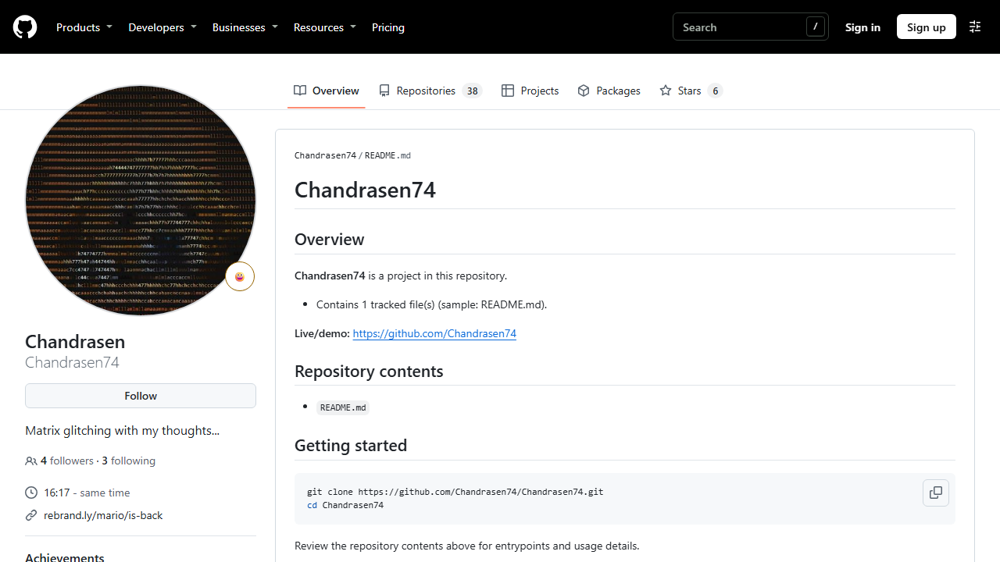

# Chandrasen74

**Live demo:** https://github.com/Chandrasen74  
**Repository:** https://github.com/Chandrasen74/Chandrasen74



## Overview
`Chandrasen74` is a project repository.

## Language & stack details
- See repository source files for implementation details.

## How to install & run
### Setup
```bash
git clone https://github.com/Chandrasen74/Chandrasen74.git
cd Chandrasen74
```
Review the repository files for project-specific prerequisites and entrypoints.

## Repository structure (top-level/sample)
- `README.md`
- `screenshot.png`

## Status
Documented with screenshot, language/stack details, and setup instructions as part of a profile-wide README update.
